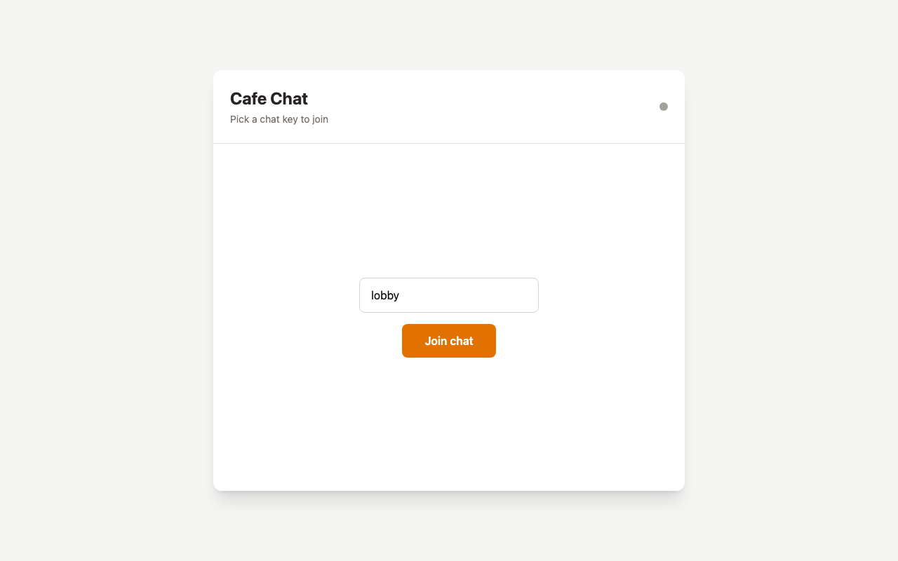
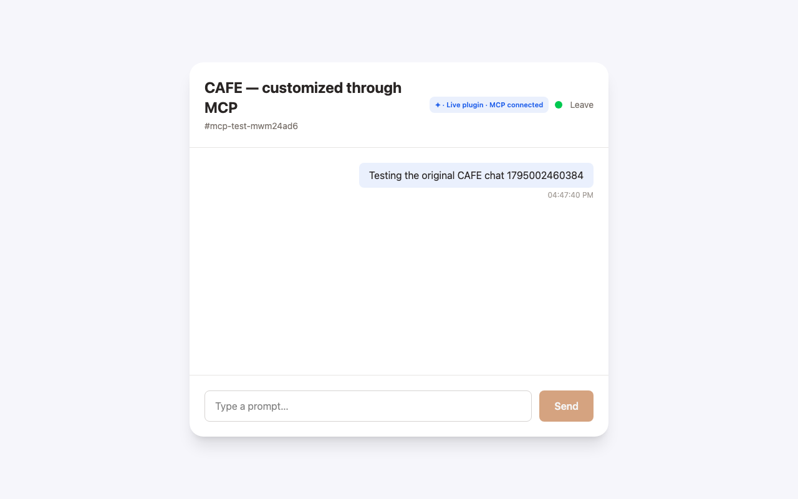

# CAFE chat + MCP plugins: original interface preserved

This is a fork of [Effect-TS/cafe](https://github.com/Effect-TS/cafe). **The original Foldkit chat UI has not been redesigned.** The room-key join form, chat bubbles, prompt composer and Leave action are still implemented by the original CAFE view.

An optional JavaScript plugin host was added. It connects to the previously working MCP service through Tailscale Funnel, and enabled plugins can change existing CAFE theme colors, header text, message highlights and small widgets without rebuilding the app.

## Visual comparison

| Original CAFE UI, no active plugins | Original CAFE UI with an MCP plugin |
| --- | --- |
|  |  |

The default layout is unchanged. No MCP URL button, plugin dashboard, account-login form or new navigation was added.

## Live addresses

- Website: https://tests-macbook-air.tail70b8a.ts.net:10000/
- Public ChatGPT MCP: https://tests-macbook-air.tail70b8a.ts.net/orbit-mcp
- Alternate public MCP: https://tests-macbook-air.tail70b8a.ts.net:10000/mcp
- Token-protected JavaScript admin MCP: https://tests-macbook-air.tail70b8a.ts.net:10000/mcp-admin

The orbit-mcp path is retained for existing ChatGPT connections. It is a networking alias only, not a visual feature.

## Using the original chat

1. Open the website. The original Cafe Chat heading and lobby room-key input appear.
2. Select **Join chat**.
3. Type a message in the original composer and press **Send**.
4. Select **Leave** to disconnect.

Upstream CAFE has **no account login/logout**. It uses room keys, not registered users. This feature deliberately does not add accounts.

### Cloudflare versus local preview

The normal CAFE Cloudflare Worker, Durable Object and Workers AI code remains unchanged. Deployed with its original Cloudflare credentials, it handles AI replies and streams events as before.

The standalone Tailscale preview runs the **same CAFE frontend** but uses a small local room adapter because Cloudflare credentials are not configured on the development Mac. This adapter supports joining rooms, sending messages, shared history and SSE updates; it **does not generate AI replies**. It is limited to local/demo builds. There is no new UI or backend product feature.

## Implementation

- packages/frontend/src/mcp-plugins.ts — optional plugin registry watcher, module loader and DOM extension host
- packages/frontend/src/entry.ts — starts the plugin host alongside Foldkit
- packages/frontend/src/main.ts — original CAFE view; only nonvisual data attributes and local preview networking switch added
- packages/frontend/src/preview-room.ts — SSE room connection, enabled for local preview only
- packages/live-mcp/server/cafe-preview-rooms.ts — local room storage and message broadcasts
- packages/live-mcp/server/index.ts — serves original CAFE build and the existing MCP endpoints
- packages/live-mcp/server/mcp.ts — existing public and admin plugin tools

The earlier Orbit React demo files are retained as history, but are **not served at the Funnel address**.

### Runtime flow

~~~text
ChatGPT connects to /orbit-mcp
  -> existing MCP customize_interface or set_demo_theme tool
  -> plugin registry stores a new revision
  -> /api/events broadcasts the change
  -> CAFE optional plugin host imports /plugins/PLUGIN_ID.js?v=VERSION
  -> original CAFE UI gets theme/header/message/widget decorations
  -> disabling plugins restores the unchanged upstream UI
~~~

The no-auth public MCP route accepts only limited visual options and generates declarative plugins. Arbitrary JavaScript source editing remains on the separate bearer-token administrator route.

## Run

~~~bash
git clone https://github.com/drunkod/orbit-social-mcp.git
cd orbit-social-mcp
pnpm install --filter @cafe/frontend... --filter @cafe/live-mcp...
pnpm dev:mcp
~~~

Local website: http://127.0.0.1:8787/

The demo build enables the preview room adapter and the plugin host. For the original Cloudflare deployment, use CAFE's own deploy commands. If VITE_MCP_PLUGINS_URL is not configured, the extra plugin host remains inert.

## Tests

~~~bash
pnpm --filter @cafe/frontend test
pnpm --filter @cafe/live-mcp test
pnpm --filter @cafe/live-mcp build
cd packages/live-mcp
pnpm exec tsx scripts/smoke-noauth.ts
pnpm exec tsx scripts/test-cafe-plugins.ts
~~~

The browser test verifies the original Join, Send and Leave behavior, then performs a real remote MCP customization and restores the baseline theme. It captures the images shown above.

## ChatGPT instruction

> Use the CAFE Chat MCP connector to change the accent to #2563eb, update the heading and create a small plugin widget, while preserving the original CAFE layout and all chat controls.

The plugin is controlled outside the chat UI. The chat UI should not explain MCP or display its connection address.

For exact Funnel commands, see [the existing no-auth Tailscale runbook](CHATGPT_MCP_NOAUTH_TAILSCALE.md). That earlier document also describes the historical Orbit demo.
