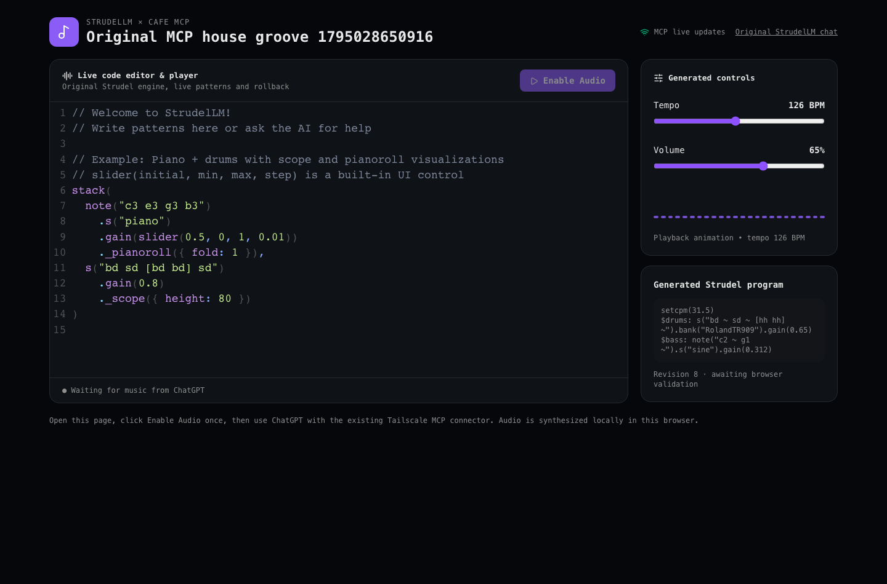

# StrudelLM × CAFE — MCP-controlled generative music

**Source:** [tambo-labs/strudellm](https://github.com/tambo-labs/strudellm), pinned at commit 99229c05 (archived October 2026). The full source is retained in [integrations/strudellm](../integrations/strudellm) with its AGPL-3.0 license and original README.md, CLAUDE.md, nested AGENTS.md, npm lockfile, source files, auth and generative UI. Read [the implementation plan](STRUDELLM_MCP_PORT_PLAN.md) for the workflow obligations and staged test gates.

## Architecture

ChatGPT's MCP connector points to the **existing** Tailscale Funnel address. ChatGPT creates musical notation and music control parameters; the server validates those inputs and compiles them into Strudel pattern code; the same Effect/Node MCP service broadcasts a revision over SSE. The preserved StrudelLM browser (Next.js + @strudel/codemirror + Web Audio) subscribes and calls its original StrudelService.updateAndPlay, which handles errors and rollback. The UI shows the live Strudel code, status, waveform-like playback animation, tempo and volume controls.

**Control:** MCP over Streamable HTTP. **Synchronization:** SSE. **Audio engine:** the original Strudel service running in the browser; no waveform/audio is transmitted by MCP. **Tunnelling:** Tailscale Funnel routes to local CAFE Node server. The music renderer is independently runnable Next.js and does not replace CAFE's Foldkit chat.

## Live endpoints

| Path | Purpose |
| --- | --- |
| https://tests-macbook-air.tail70b8a.ts.net:10000/ | Original CAFE chat, unchanged |
| https://tests-macbook-air.tail70b8a.ts.net:10000/music/studio | Music Studio running preserved StrudelLM audio engine and new MCP bridge |
| https://tests-macbook-air.tail70b8a.ts.net:10000/music/chat | Original Tambo chat UI (requires NEXT_PUBLIC_TAMBO_API_KEY) |
| https://tests-macbook-air.tail70b8a.ts.net/orbit-mcp | Existing public ChatGPT MCP connector, now also contains music tools |
| https://tests-macbook-air.tail70b8a.ts.net:10000/mcp | Same public MCP served through the app port |
| https://tests-macbook-air.tail70b8a.ts.net:10000/mcp-admin | Existing bearer-protected admin MCP; now also has unrestricted Strudel source updates |
| /music-sync/state | Current generated Strudel source, metadata, version, UI controls, browser playback feedback |
| /music-sync/events | Server-Sent Events revision notifications |
| /music-sync/controls | Tempo/volume update POST from Studio UI |
| /music-sync/feedback | Browser playback success/error acknowledgement |
| /music-sync/stop and /music-sync/play | Stop/resume synchronization from browser controls |

The full original StrudelLM app is preserved; the public /music/studio route is a new keyless **ChatGPT MCP** alternative to Tambo's embedded chat, not a replacement of it.

## Local development (following original upstream workflow)

The CAFE root uses pnpm and Node 26, while StrudelLM uses its original **npm** workflow and requires Node 20–25 due to pinned better-sqlite3. **Use Node 24 for StrudelLM; do not change CAFE's existing Node version.** On the connected Mac, Node 24 is installed under /opt/homebrew/opt/node@24/bin.

Terminal A:

~~~bash
cd ~/Documents/Work/cafe-mcp-live/integrations/strudellm
export PATH="/opt/homebrew/opt/node@24/bin:$PATH"
npm ci
npm run lint
npm run build
PORT=3105 npm run dev
~~~

Terminal B:

~~~bash
cd ~/Documents/Work/cafe-mcp-live
pnpm dev:mcp
~~~

Or use the root helper to start both applications:

~~~bash
pnpm dev:music
~~~

**Original Tambo setup:** If you want the original StrudelLM /music/chat conversation as well as ChatGPT MCP, run npx tambo init inside integrations/strudellm and set NEXT_PUBLIC_TAMBO_API_KEY in its local .env.local. Do not commit secrets. The /music/studio page does not need a Tambo key: AI text generation happens in ChatGPT instead.

## ChatGPT example workflow

Open /music/studio in a browser. Click **Enable Audio** once when the Strudel engine is ready. Connect ChatGPT's existing MCP plugin URL and ask:

> Make an original deep-house groove at 126 BPM. Use a Roland 909 kick, snare on alternating beats, eight hi-hats, a gentle sine-wave bass in C minor, and give me interactive tempo and volume controls. Play it in the Music Studio.

ChatGPT calls music_list_sounds (optional) then music_compose with a typed parameter object. Example of tool arguments:

~~~json
{
  "title": "Original Deep House",
  "bpm": 126,
  "bank": "RolandTR909",
  "drums": "bd ~ sd ~ [hh hh] ~",
  "bass": "c2 ~ g1 ~",
  "instrument": "sine",
  "volume": 0.65,
  "color": "#8b5cf6"
}
~~~

The generated Strudel source is displayed in the Studio and changes instantly on the next MCP call. Changing the tempo/volume sliders updates both code and the audio engine. The browser sends validation feedback; music_get_state reveals confirmed playing/error state. Browser autoplay restrictions mean **remote MCP cannot make a brand-new browser tab audible until its audio context is first activated by a user gesture**.

## Available MCP tools

| Tool | Purpose |
| --- | --- |
| music_get_state | Inspect generated code, revision, controls, last browser feedback |
| music_list_sounds | Retrieve known drum banks and instruments / mini-notation examples |
| music_compose | Generate original multi-track Strudel code from constrained drum, bass and melody patterns |
| music_set_controls | Adjust tempo/volume; regenerate code and live sliders |
| music_stop | Stop music in subscribed studio tabs |
| music_play | Resume last generated code in audio-enabled studio tabs |
| music_update_strudel_code | **Admin MCP only:** supply unrestricted Strudel JavaScript source, executed with upstream validation and rollback |

The source's own validateAndUpdateRepl, listSamples, playback code, Tambo provider, generative UI widgets and auth are still included. The public no-auth MCP intentionally compiles structured notation rather than accepting arbitrary executable browser JavaScript. ChatGPT still authors the rhythm and musical choices.

## Verification commands

~~~bash
cd ~/Documents/Work/cafe-mcp-live
pnpm --filter @cafe/live-mcp typecheck
pnpm --filter @cafe/live-mcp test
cd packages/live-mcp
pnpm exec tsx scripts/smoke-music.ts
pnpm exec tsx scripts/test-music-studio.ts

cd ../../integrations/strudellm
npm run lint
npm run build
~~~

Verified on Node 24: npm ci, npm run lint (six upstream warnings; zero errors), npm run build and production serving at /music/studio. The MCP unit test verifies sample/pattern schema validation, durable state, slider mutations, revisions and playback feedback. The visual Playwright test verifies MCP mutation, dynamic controls, and two viewport sizes. **Headless web testing cannot certify physical audio output**; listen in a browser, monitor the console and check music_get_state.feedback for actual Strudel evaluation status.

## Limitations and follow-up stages

The original StrudelLM codebase is imported in full, but optional Tambo cloud authentication, magic-link email delivery and its production databases require their original credentials and were not reimplemented as part of the MCP bridge. The music engine is still a browser AudioContext: an always-on playout host is required for broadcast audio. The Studio currently generates tempo/volume slider controls from metadata; arbitrary UI generation inside ChatGPT would be a separate MCP Apps capability. A staged admin plugin can expose more of the Strudel DSL once a dedicated code review/sandbox model is chosen.

**Licensing:** Source import carries AGPL-3.0; preserve license and attribution and assess whether network publication of a combined service entails source-sharing obligations.
