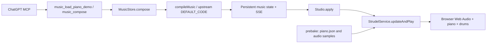

# StrudelLM × CAFE — MCP-controlled generative music

**Source:** [tambo-labs/strudellm](https://github.com/tambo-labs/strudellm), pinned at commit 99229c05 (archived October 2026). The full source is retained in [integrations/strudellm](../integrations/strudellm) with its AGPL-3.0 license and original README.md, CLAUDE.md, nested AGENTS.md, npm lockfile, source files, auth and generative UI. Read [the implementation plan](STRUDELLM_MCP_PORT_PLAN.md) for the workflow obligations and staged test gates.

## Architecture

ChatGPT's MCP connector points to the **existing** Tailscale Funnel address. ChatGPT creates musical notation and music control parameters; the server validates those inputs and compiles them into Strudel pattern code; the same Effect/Node MCP service broadcasts a revision over SSE. The preserved StrudelLM browser (Next.js + @strudel/codemirror + Web Audio) subscribes and calls its original StrudelService.updateAndPlay, which handles errors and rollback. The UI shows the live Strudel code, status, waveform-like playback animation, tempo and volume controls.

**Control:** MCP over Streamable HTTP. **Synchronization:** SSE. **Audio engine:** the original Strudel service running in the browser; no waveform/audio is transmitted by MCP. **Tunnelling:** Tailscale Funnel routes to local CAFE Node server. The music renderer is independently runnable Next.js and does not replace CAFE's Foldkit chat.

## Live endpoints

| Path | Purpose |
| --- | --- |
| https://tests-macbook-air.tail70b8a.ts.net:10000/ | Original CAFE chat, unchanged |
| https://tests-macbook-air.tail70b8a.ts.net:10000/music/studio | Music Studio running preserved StrudelLM audio engine and new MCP bridge |
| https://tests-macbook-air.tail70b8a.ts.net:10000/music/chat | Original Tambo chat UI (requires NEXT_PUBLIC_TAMBO_API_KEY) |
| https://tests-macbook-air.tail70b8a.ts.net/orbit-mcp | Existing public ChatGPT MCP connector, now also contains music tools |
| https://tests-macbook-air.tail70b8a.ts.net:10000/mcp | Same public MCP served through the app port |
| https://tests-macbook-air.tail70b8a.ts.net:10000/mcp-admin | Existing bearer-protected admin MCP; now also has unrestricted Strudel source updates |
| /music-sync/state | Current generated Strudel source, metadata, version, UI controls, browser playback feedback |
| /music-sync/events | Server-Sent Events revision notifications |
| /music-sync/controls | Tempo/volume update POST from Studio UI |
| /music-sync/feedback | Browser playback success/error acknowledgement |
| /music-sync/stop and /music-sync/play | Stop/resume synchronization from browser controls |

The full original StrudelLM app is preserved; the public /music/studio route is a new keyless **ChatGPT MCP** alternative to Tambo's embedded chat, not a replacement of it.

## Local development (following original upstream workflow)

The CAFE root uses pnpm and Node 26, while StrudelLM uses its original **npm** workflow and requires Node 20–25 due to pinned better-sqlite3. **Use Node 24 for StrudelLM; do not change CAFE's existing Node version.** The imported package has a minimal, reviewed `allowScripts` addition pinned to `better-sqlite3@12.5.0`, `sharp@0.34.5` and `unrs-resolver@1.11.1` so clean npm 11 installs can run these required native setup scripts. The upstream npm lockfile is otherwise unchanged. On the connected Mac, Node 24 is installed under /opt/homebrew/opt/node@24/bin.

Terminal A:

~~~bash
cd ~/Documents/Work/cafe-mcp-live/integrations/strudellm
export PATH="/opt/homebrew/opt/node@24/bin:$PATH"
npm ci
npm run lint
npm run build
PORT=3105 npm run dev
~~~

Terminal B:

~~~bash
cd ~/Documents/Work/cafe-mcp-live
pnpm dev:mcp
~~~

Or use the root helper to start both applications:

~~~bash
pnpm dev:music
~~~

**Original Tambo setup:** If you want the original StrudelLM /music/chat conversation as well as ChatGPT MCP, run npx tambo init inside integrations/strudellm and set NEXT_PUBLIC_TAMBO_API_KEY in its local .env.local. Do not commit secrets. The /music/studio page does not need a Tambo key: AI text generation happens in ChatGPT instead.

## ChatGPT example workflow

Open /music/studio in a browser. Click **Enable Audio** once when the Strudel engine is ready. Connect ChatGPT's existing MCP plugin URL and ask:

> Make an original deep-house groove at 126 BPM. Use a Roland 909 kick, snare on alternating beats, eight hi-hats, a gentle sine-wave bass in C minor, and give me interactive tempo and volume controls. Play it in the Music Studio.

ChatGPT calls music_list_sounds (optional) then music_compose with a typed parameter object. Example of tool arguments:

~~~json
{
  "title": "Original Deep House",
  "bpm": 126,
  "bank": "RolandTR909",
  "drums": "bd ~ sd ~ [hh hh] ~",
  "bass": "c2 ~ g1 ~",
  "instrument": "sine",
  "volume": 0.65,
  "color": "#8b5cf6"
}
~~~

The generated Strudel source is displayed in the Studio and changes instantly on the next MCP call. Changing the tempo/volume sliders updates both code and the audio engine. The browser sends validation feedback; music_get_state reveals confirmed playing/error state. Browser autoplay restrictions mean **remote MCP cannot make a brand-new browser tab audible until its audio context is first activated by a user gesture**.

## Why the original StrudelLM demo sounded more melodic

CodeGraph index and `codegraph context`/`codegraph impact compileMusic` traced the real path from `music_compose` to `compileMusic` to `MusicStore` and `StrudelService.updateAndPlay`, with `prebake` resolving piano samples. The first MCP bridge **did not** compile the stock StrudelLM example: it used a low-frequency sine-wave bass, fixed TR-909 bank, and smaller track gains in place of the original sampled acoustic piano. The StrudelLM playback engine itself was not replaced or modified.

The corrected public MCP endpoint offers **`music_load_piano_demo`** (no arguments), which generates the original upstream `StrudelService.DEFAULT_CODE` verbatim: `note("c3 e3 g3 b3").s("piano")`, piano volume `slider(0.5, 0, 1, 0.01)`, `._pianoroll({ fold: 1 })`, and `s("bd sd [bd bd] sd").gain(0.8)._scope({ height: 80 })`. The regular `music_compose({preset:"piano-drums"})` uses the same demo by default. When BPM or gain is changed, only the corresponding tempo prefix or built-in piano slider changes; the instrument and rhythm remain intact. The custom composer additionally supports `instrument: "piano"` and `bank: "default"` (unbanked stock drum samples).

**Live SSE correctness:** CodeGraph also exposed a UI race: if a sample was still loading, the previous Studio ignored newer MCP revisions while the REPL was busy. The Studio now retains the highest pending revision (including stop requests), processes it after the current evaluation, and ignores out-of-order HTTP refreshes. A GitHub Linux browser test exposed the lost-update bug, while the subsequent isolated browser retest confirmed the corrected behavior.

**Test-first acceptance:** new test first failed with the generated TR-909-only source when compared byte-for-byte against the upstream default, then passed after implementing the preset and tool. A real Chromium end-to-end test confirmed original code, successful audio-engine evaluation, the default piano sample-map and C3/D♯3/F♯3/C4 MP3 requests returning 200, and all visualizations being emitted. This checks browser sound loading, not physical speaker output. The unrelated CAFE chat and plugin regression still passed.

**Try it in ChatGPT:** choose the existing CAFE Music Studio plugin and ask: *"Use `music_load_piano_demo` to play the exact original StrudelLM piano-and-drums example in my Music Studio. Do not replace the piano with a sine bass. Then call `music_get_state` to confirm it."* Keep https://tests-macbook-air.tail70b8a.ts.net:10000/music/studio open and click **Enable Audio** once.

### CodeGraph analysis of the audio path

## Available MCP tools

| Tool | Purpose |
| --- | --- |
| music_load_piano_demo | Reproduce exactly the original StrudelLM melodic piano-and-drums sample, visualizations and inline piano slider |
| music_get_state | Inspect generated code, revision, controls, last browser feedback |
| music_list_sounds | Retrieve known drum banks and instruments / mini-notation examples |
| music_compose | Generate original multi-track Strudel code from constrained drum, bass and melody patterns |
| music_set_controls | Adjust tempo/volume; regenerate code and live sliders |
| music_stop | Stop music in subscribed studio tabs |
| music_play | Resume last generated code in audio-enabled studio tabs |
| music_update_strudel_code | **Admin MCP only:** supply unrestricted Strudel JavaScript source, executed with upstream validation and rollback |

The source's own validateAndUpdateRepl, listSamples, playback code, Tambo provider, generative UI widgets and auth are still included. The public no-auth MCP intentionally compiles structured notation rather than accepting arbitrary executable browser JavaScript. ChatGPT still authors the rhythm and musical choices.

## Verification commands

~~~bash
cd ~/Documents/Work/cafe-mcp-live
pnpm --filter @cafe/live-mcp typecheck
pnpm --filter @cafe/live-mcp test
cd packages/live-mcp
pnpm exec tsx scripts/smoke-music.ts
pnpm exec tsx scripts/test-music-studio.ts

cd ../../integrations/strudellm
npm run lint
npm run build
~~~

Verified on Node 24: npm ci, npm run lint (six upstream warnings; zero errors), npm run build and production serving at /music/studio. The MCP unit test verifies sample/pattern schema validation, durable state, slider mutations, revisions and playback feedback. The visual Playwright test verifies MCP mutation, dynamic controls, and two viewport sizes. **Headless web testing cannot certify physical audio output**; listen in a browser, monitor the console and check music_get_state.feedback for actual Strudel evaluation status.

## Limitations and follow-up stages

The original StrudelLM codebase is imported in full, but optional Tambo cloud authentication, magic-link email delivery and its production databases require their original credentials and were not reimplemented as part of the MCP bridge. The music engine is still a browser AudioContext: an always-on playout host is required for broadcast audio. The Studio currently generates tempo/volume slider controls from metadata; arbitrary UI generation inside ChatGPT would be a separate MCP Apps capability. A staged admin plugin can expose more of the Strudel DSL once a dedicated code review/sandbox model is chosen.

**Licensing:** Source import carries AGPL-3.0; preserve license and attribution and assess whether network publication of a combined service entails source-sharing obligations.

## CAFE `AGENTS.md` workflow evidence for the music PR

The **CAFE root `AGENTS.md`** remains the authoritative repository-wide engineering contract, supplemented by upstream StrudelLM `CLAUDE.md` and its nested `src/components/tambo/AGENTS.md`. This implementation follows the documented red → green → real infrastructure → PR cycle:

1. **Tests before implementation.** Extended the music browser e2e to require a playback acknowledgement and a recorded PR demo. The red test failed with `ENOENT: strudel-studio-demo.webm`. Added Playwright's actual video recorder, installed its FFmpeg helper, and reran the test green.
2. **Isolated worktree and branch.** The source port was committed on `feat/strudellm-mcp-foundation`. Follow-up tests, CAFE Effect config conventions, demo recorder and CI were developed in an independent worktree on `feat/strudellm-mcp-workflow`, without editing the live Funnel server worktree.
3. **Local suites and real-browser infrastructure.** `pnpm typecheck`, `pnpm lint`, the existing Foldkit Story/Scene tests (26 passing), MCP unit tests (5 passing), original StrudelLM `npm ci`/`npm run lint`/`npm run build`, and an isolated pair of production HTTP servers using the same MCP/Strudel code all passed. The new PR acceptance script verifies API tools, original CAFE chat and plugin behavior, audio-engine playback acknowledgement, generated slider mutations, mobile rendering, and a real recorded WebM demo.
4. **GitHub PR gate.** `.github/workflows/music-pr.yml` reproduces those steps on Node 24 in CI, uploads browser screenshots/video/server logs and posts a demo-artifact link on the PR. The original upstream CAFE workflow and StrudelLM workflow are retained.
5. **Cloudflare-specific limit.** `pnpm exec alchemy provider check-env --provider Cloudflare` reports missing `CLOUDFLARE_ACCOUNT_ID` and `CLOUDFLARE_API_TOKEN`/`CLOUDFLARE_API_KEY`. Therefore the **Cloudflare test deployment and per-PR Cloudflare preview cannot yet be verified or enabled in this fork**. The previously verified Tailscale Funnel and the separate CI production HTTP servers are real servers, but neither is a Cloudflare PR preview. Add Cloudflare credentials with a dedicated Alchemy testing profile before claiming that gate is complete; do not expose tokens in source or logs.

To reproduce the isolated PR demo locally after building both applications:

~~~bash
cd ~/Documents/Work/cafe-mcp-music-workflow
pnpm --filter @cafe/live-mcp build
(cd integrations/strudellm && PATH="/opt/homebrew/opt/node@24/bin:$PATH" npm ci && npm run build)
pnpm --filter @cafe/live-mcp exec playwright install ffmpeg
MUSIC_ARTIFACT_DIR=/tmp/cafe-music-review bash scripts/test-music-pr.sh
~~~

The test runner uses its own HTTP ports `8877` and `3107` and cleans up those processes afterward. The review artifact includes `strudel-studio-demo.webm`, two Studio screenshots, and server logs.
