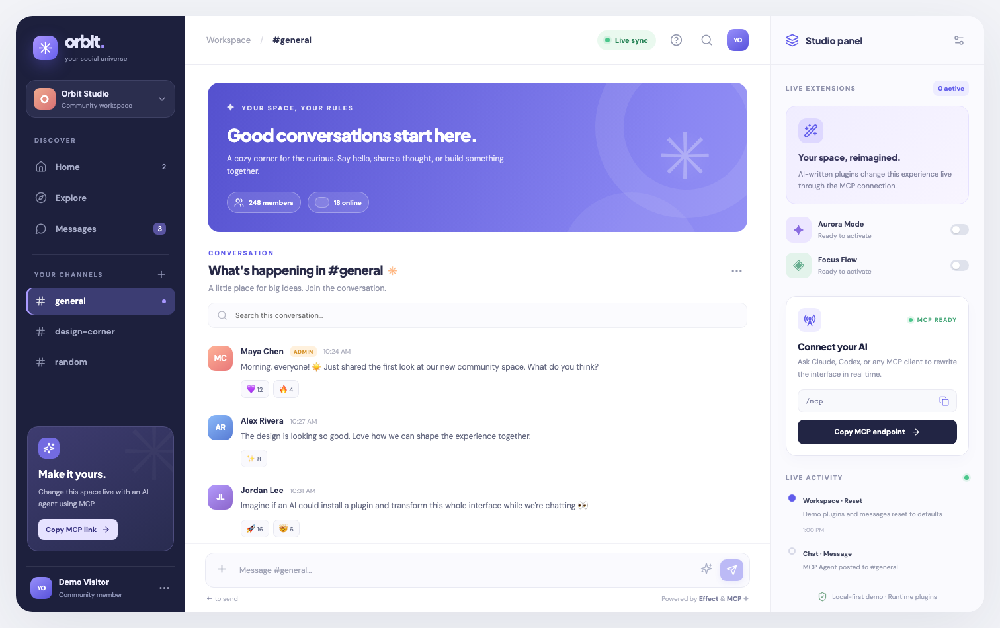
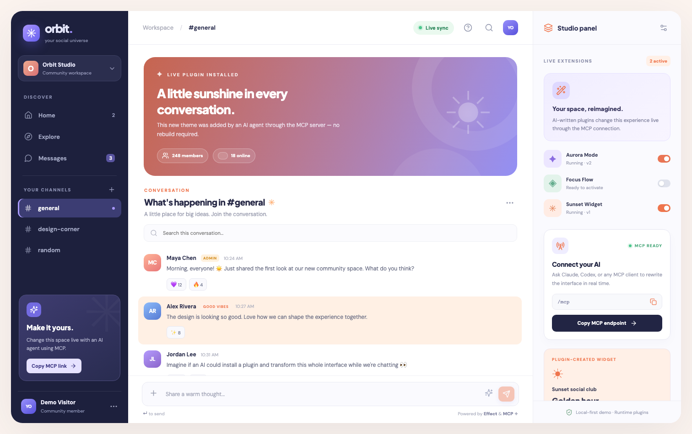

# What is implemented and verified

> **Historical Orbit-demo notes.** The Tailscale Funnel and no-auth MCP endpoints described here still work, but the live website now serves the **original CAFE chat UI**. See [CAFE MCP integration](CAFE_MCP_INTEGRATION.md) for the current application and screenshots.

**Project:** Orbit Social — live customization of a JavaScript social/chat app with Effect, MCP and Tailscale Funnel.
**Upstream fork:** [Effect-TS/cafe](https://github.com/Effect-TS/cafe).
**Working ChatGPT connection confirmed by the user:** 18 November 2026.
**Full setup:** [ChatGPT MCP and Tailscale no-auth runbook](CHATGPT_MCP_NOAUTH_TAILSCALE.md).

## Live MVP

- **App URL:** https://tests-macbook-air.tail70b8a.ts.net:10000/
- **ChatGPT no-auth MCP URL:** https://tests-macbook-air.tail70b8a.ts.net/orbit-mcp
- **Alternate public MCP URL:** https://tests-macbook-air.tail70b8a.ts.net:10000/mcp
- **Admin MCP URL (token required):** https://tests-macbook-air.tail70b8a.ts.net:10000/mcp-admin

The live URL works only while the Mac, Tailscale and the app's Node process remain online. The existing Tailscale 443 root service and private 8443 service were preserved.

## Functional checklist

| Component | Implemented | Observed verification |
| --- | --- | --- |
| CAFE-based Effect/TypeScript codebase | Yes | Preserved upstream repository and added packages/live-mcp |
| Social/chat website | Yes | Headless Chromium rendered the interface successfully |
| Chat message posting | Yes | MCP client posted a message; state revision and message count changed |
| Persistent plugin registry | Yes | Node tests verified add/update/enable/remove and JSON persistence |
| Real MCP Streamable HTTP server | Yes | Official MCP client discovered and called tools over local and public URLs |
| No-auth public MCP endpoint | Yes | SDK client invoked tools with no auth header on standard HTTPS 443 |
| Public no-auth tool set limited to visual changes | Yes | Public MCP tools list contains exactly four tools and excludes source-code installation |
| Authenticated administrator MCP | Yes | No-token request returned HTTP 401; authorized client exercised plugin code tools |
| Plugin installation at runtime | Yes | MCP installed the JavaScript Sunset Widget without rebuilding |
| Live interface hot reload | Yes | Browser saw changed banner, accent color, badge and sidebar widget |
| Tailscale Funnel HTTPS on port 10000 | Yes | Live HTTPS endpoint and /health returned HTTP 200 |
| Additional public HTTPS 443 alias | Yes | Streamable HTTP MCP handshake succeeded through /orbit-mcp |
| Separate user-facing ChatGPT plugin | Yes | User confirmed connection works in ChatGPT |
| TypeScript build and typecheck | Yes | Both passed |
| Automated store tests | Yes | Two passed |
| Browser errors in visual test | None reported | Headless browser emitted an empty error array during the test |

## Before: stock Orbit Social interface

## After: MCP-installed Sunset Widget and Aurora Mode

The visual test executed MCP actions against the public Funnel URL and verified:

~~~json
{
  "before": "Good conversations start here.",
  "after": "A little sunshine in every conversation.",
  "background": "rgb(255, 245, 237)",
  "pluginWidget": 1,
  "activeCount": 2,
  "errors": []
}
~~~

The screenshots are from the **earlier admin-MCP plugin installation test**, while the **later no-auth public MCP test** specifically activated the Focus Flow preset and created the ChatGPT Visual Designer plugin with the blue #2563eb accent.

## Exactly what ChatGPT is allowed to do without authentication

ChatGPT can call four limited MCP tools: <code>get_app_info</code>, <code>list_demo_themes</code>, <code>set_demo_theme</code> and <code>customize_interface</code>. The customization tool accepts validated colors and copy, generates the declarative plugin itself, persists it and broadcasts the changed revision to all connected browsers.

Unauthenticated clients **cannot upload arbitrary JavaScript source, edit the filesystem, launch shell commands or call the administrator's plugin-source-editing tools** through the public MCP route.

The admin MCP route separately supports JavaScript plugin installation and source editing using a bearer token from the ignored local file.

## Validation commands

~~~bash
cd packages/live-mcp

# Read-only verification: no token, no state modification
MCP_ENDPOINT=https://tests-macbook-air.tail70b8a.ts.net/orbit-mcp \
  pnpm exec tsx scripts/smoke-noauth.ts

# Local unit verification
pnpm typecheck
pnpm build
pnpm test

# Mutating test: changes the public demo theme and widgets
MCP_ENDPOINT=https://tests-macbook-air.tail70b8a.ts.net/orbit-mcp \
DEMO_STATE_URL=https://tests-macbook-air.tail70b8a.ts.net:10000/api/state \
  pnpm exec tsx scripts/test-chatgpt-noauth.ts
~~~

The public 443 alias returned 406 on a raw HTTP GET without the required MCP Accept headers. The full MCP client completed the handshake and calls, so 406 is not a deployment failure.

## Known limitations

This is a demonstration, not a production OAuth server. The visual demo is shared; any external client connecting to the public MCP address can alter the same visible UI. The administrator's arbitrary JavaScript plugins are trusted client-side code without a hardened sandbox. The website and MCP endpoint depend on a running Mac, online Tailscale service and running Node process. The project does not persist individual users, perform real social-network authentication, or deploy the upstream CAFE Cloudflare Worker.
